<p align="center">
  
</p>

<p align="center"></p>
<h1 align="center">Loop</h1>
<p align="center"><strong>Make AI feedback easier to capture and reason about.</strong></p>
<p align="center">A Python SDK and validation API for recording model interactions, collecting feedback, and describing training-data formats.</p>

<p align="center">
  <a href="https://github.com/ahmadjamilofficial/Loop"></a>
  
  
  
</p>

<p align="center">
  <a href="#quickstart">Quickstart</a> ·
  <a href="#update-the-sdk-from-the-command-line">Update SDK</a> ·
  <a href="https://loop-systematic-architecture-api-index.vercel.app/docs">API docs</a> ·
  <a href="loop-python/README.md">Python SDK</a>
</p>

---

## Overview

AI products generate signals that are easy to lose: which answers people value, where a response needs correction, and which model produced it. Loop provides a small, typed interface for submitting those signals and receiving validated acknowledgements.

**Loop is an SDK and API layer, not a model runtime or evaluator.** It does not call an LLM, judge answer quality, or append an evaluation to a model response. Your application supplies the prompt, response, model label, and any feedback.

### What it provides

| Capability | Description |
|---|---|
| Interaction requests | Submit a prompt and response, with optional model, metadata, session ID, timestamp, or client ID. |
| Feedback requests | Submit `up` / `down` feedback and an optional correction or comment. |
| Batch requests | Validate batches of up to 100 interactions. |
| Format descriptions | Retrieve schemas for Chat JSONL, Alpaca JSONL, and DPO JSONL. |
| Health and stats | Check API status and validate/echo a summary you provide. |
| Python client | Sync and async methods, typed models, HTTPX transport, and configurable timeouts. |

## Data handling and current scope

The hosted API is stateless. Successful interaction and feedback responses currently include `stored: false`: they acknowledge/validate requests but do not mean records were saved remotely. The API does not execute models or perform model evaluation. `export_formats()` returns format descriptions and examples; it does not download or generate a training dataset.

The repository describes a local-first JSONL storage/export architecture, but the generated SDK currently provides API operations rather than a confirmed end-to-end local persistence or `loop` command-line application. Do not rely on local storage, CLI export, or training-data generation unless you have separately verified the implementation you are using. Avoid sending unnecessary personal or sensitive data.

## Quickstart

### Install from GitHub

The Python package lives in `loop-python/` and supports Python 3.10+.

```bash
python -m pip install 'git+https://github.com/ahmadjamilofficial/Loop.git#subdirectory=loop-python'
```

### Check API health

```python
from loop import Loop

with Loop() as client:
    response = client.health.health()
    print(response.result)
```

A successful health result includes the API status and version.

### Submit an interaction and feedback

```python
from loop import Loop

with Loop() as client:
    interaction = client.interactions.log_interaction(
        prompt="What is the capital of Pakistan?",
        response="Islamabad.",
        model="my-model-v1",
        metadata={"application": "my-ai-app", "environment": "development"},
        session_id="session_001",
    )

    interaction_id = interaction.result.id
    print("Interaction ID:", interaction_id)

    feedback = client.feedback.submit_feedback(
        interaction_id=interaction_id,
        rating="up",
    )
    print(feedback.result)
```

For negative feedback, use `rating="down"` and optionally supply a `correction` and `comment`. Treat corrections as unverified user input; review them before using as training labels.

## Update the SDK from the command line

There is currently **no standalone `loop` CLI** and no `loop update` command. Update the Python package from a terminal with pip:

```bash
python -m pip install --upgrade --force-reinstall --no-cache-dir \
  'git+https://github.com/ahmadjamilofficial/Loop.git#subdirectory=loop-python'
```

This reinstalls the package from the repository's current default branch. To install a particular branch or commit, append a VCS ref before the subdirectory fragment, for example:

```bash
python -m pip install --force-reinstall --no-cache-dir \
  'git+https://github.com/ahmadjamilofficial/Loop.git@main#subdirectory=loop-python'
```

Check the installed distribution version with:

```bash
python -c "from importlib.metadata import version; print(version('loopsdk'))"
```

The source metadata currently reports `0.0.2`. Until the project publishes version changes, that number may stay the same across Git commits; pin a commit SHA when reproducible builds matter.

## API surface

| Method | Endpoint | Purpose |
|---|---|---|
| `GET` | `/v1/health` | API status and version. |
| `POST` | `/v1/interactions` | Validate one prompt/response pair and return an ID. |
| `POST` | `/v1/interactions/batch` | Validate up to 100 interactions. |
| `POST` | `/v1/feedback` | Validate and acknowledge feedback. |
| `GET` | `/v1/export/formats` | Return export schema descriptions. |
| `POST` | `/v1/stats` | Validate and echo caller-provided summary values. |

Production API: [`loop-systematic-architecture-api-index.vercel.app`](https://loop-systematic-architecture-api-index.vercel.app) · [Interactive API reference](https://loop-systematic-architecture-api-index.vercel.app/docs)

The SDK response wrapper exposes response headers and a typed `result`; responses include an `X-Request-Id` for tracing. Validation errors use HTTP 422.

## Feedback data formats

Loop describes three common training formats:

- **Chat JSONL** — role/content message arrays.
- **Alpaca JSONL** — instruction, optional input, and output.
- **DPO JSONL** — prompt plus chosen and rejected answers.

A documented mapping treats corrected negative feedback as a possible preferred/rejected pair. This is a format convention, not a quality guarantee: corrections require human review before training.

## Configuration

```python
from loop import Loop

with Loop(timeout_ms=30_000) as client:
    print(client.health.health().result)
```

Use `server_url="http://localhost:8000"` to target a local API, or pass a custom HTTPX client as documented in the SDK reference. The generated client supports synchronous and asynchronous context managers; the context manager closes SDK-managed connections.

## Development

```bash
git clone https://github.com/ahmadjamilofficial/Loop.git
cd Loop
python -m pip install -r requirements.txt
uvicorn api.app.main:app --reload --port 8000
```

The API is then available at `http://localhost:8000`; Swagger UI is at `http://localhost:8000/docs`.

The SDK source is in `loop-python/`. For editable installation from the repository root:

```bash
python -m pip install -e ./loop-python
```

The SDK is generated from the OpenAPI specification. Make durable SDK contract changes in the source specification/generation workflow rather than hand-editing generated files.

## Maturity

Loop is **beta**. Interfaces and generated models may change. Before production use, verify the live API behavior, pin a release or commit, test error/retry handling, confirm persistence and export behavior in the exact SDK version, and review privacy and retention requirements.

## Contributing and license

Issues and pull requests are welcome: [github.com/ahmadjamilofficial/Loop](https://github.com/ahmadjamilofficial/Loop).

The OpenAPI specification identifies the repository as MIT-licensed, while the Python package metadata currently declares Apache-2.0. These declarations should be reconciled by the maintainers before release.
